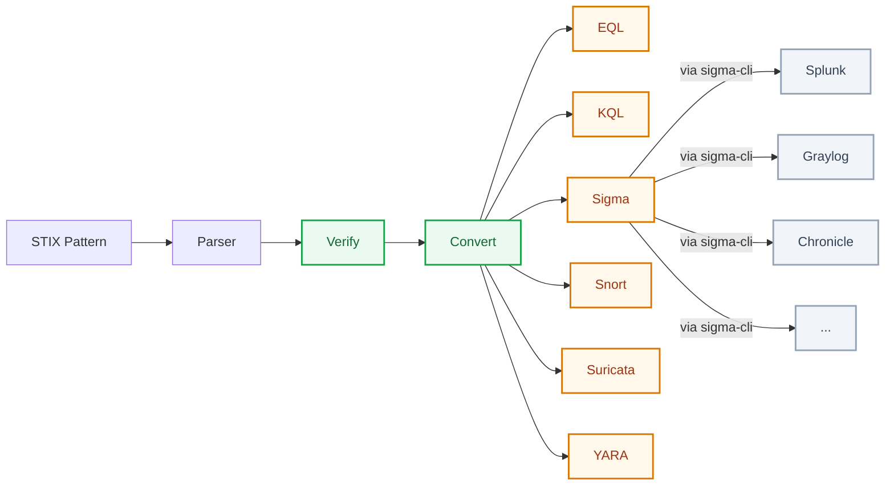

# SPUC (STIX Pattern Universal Converter)

SPUC is a Rust CLI that parses STIX 2.1 patterns, normalizes them to IR, and emits detection content for EQL, KQL, Sigma, Snort, Suricata, and YARA.



## Status

- Parser: `pest` grammar for STIX-style expressions.
- Normalization: AST to IR (`IrExpr`, `IrPredicate`) with semantic validation.
- Emitters:
  - EQL and KQL for endpoint/EDR-style hunting queries.
  - Sigma for SIEM-style detections.
  - Snort and Suricata for IDS network signatures.
  - YARA for content/malware-style signatures.

## STIX Scope

- STIX 2.1 only.
- Object paths are validated before emitter scoring/conversion.

## Usage

```bash
spuc convert --rule "[ipv4-addr:value = '127.0.0.1']" --to sigma --to eql --to kql
spuc convert --rule "[network-traffic:src_ref.value = '10.0.0.5'] AND [network-traffic:dst_port = 443]" --to snort --to suricata
spuc convert --rule "([process:name = 'cmd.exe'] FOLLOWEDBY [process:name = 'powershell.exe']) WITHIN 300 SECONDS" --to eql
spuc convert --rule "[ipv4-addr:value ISSUBSET '198.51.100.0/24']" --to sigma --to eql --to kql --rule-confidence 80
spuc doc --target sigma
spuc learn --list
spuc --version
```

## CLI Help Sample

```text
$ spuc help

SPUC is a Rust CLI that parses STIX 2.1 patterns, normalizes them to IR, and emits detection content for EQL, KQL, Sigma, Snort, Suricata, and YARA.

Usage: spuc [COMMAND]

Commands:
  convert   Convert STIX patterns to selected targets
  verify    Verify that STIX pattern(s) parse/normalize successfully
  doc       Show converter documentation and coverage details [aliases: coverage, cover]
  learn     Guided CTF-like learning mode for writing STIX patterns
  serve     Run a simple JSON-RPC-like service [aliases: service]
  interact  Interactive TUI (REPL-style) [aliases: interactive]
  help      Print this message or the help of the given subcommand(s)

Options:
  -V, --version  Print version and exit
  -h, --help  Print help
```

## Testing

```bash
cargo test
```

## CI/CD Pipeline

This repository is prepared for automated builds in GitHub Actions:

- `.github/workflows/ci.yml`
  - runs `cargo fmt --check`, `cargo check -q`, and `cargo test -q` on push/PR.
- `.github/workflows/release.yml`
  - builds release binaries for Linux, macOS, and Windows.
  - includes ARM targets for Raspberry Pi (`aarch64-unknown-linux-gnu` and `armv7-unknown-linux-gnueabihf`) plus `x86_64-unknown-linux-musl`.
  - packages artifacts with the current app version in filename (`spuc-v<version>-<target>.tar.gz` / `.zip`).
  - uploads build artifacts on each run.
  - publishes GitHub Release assets automatically when pushing a tag like `v0.1.1`.

Release flow:

```bash
git tag v0.1.1
git push origin v0.1.1
```

## Available Targets

- `eql`
- `kql`
- `sigma`
- `snort`
- `suricata`
- `yara`

## Semantic Fidelity Status

Each conversion returns exactly one runtime status:

- `exact`: target semantics and data-model assumptions are preserved.
- `schema-dependent`: mapping is valid but depends on backend field schema/profile.
- `backend-dependent`: mapping depends on runtime/backend behavior (regex engine, pipeline, helper semantics).
- `partial`: only a supported subset is emitted; semantic constraints are explicitly omitted/advisory.
- `lossy`: related conversion exists, but semantics are degraded.
- `unsupported`: no honest mapping is available in the current baseline.

Confidence is independent and explicit:

- `conversion_confidence` (`0..100`): SPUC semantic-fidelity confidence.
- `rule_confidence` (`0..100`, optional): analyst/indicator confidence via `--rule-confidence`.

`convert` modes:

- `--mode strict` (default): if required predicates are not representable faithfully, output is `unsupported`.
- `--mode partial`: supported subset only, status `partial`, omitted parts noted.


## Result Model and CSV

Runtime output keeps semantic fidelity and analyst confidence separated:

- `runtime_status`
- `conversion_confidence`
- `rule_confidence`
- `cause`
- `summary`
- `notes`
- `output`

CSV columns:

- `input_rule,target,runtime_status,conversion_confidence,rule_confidence,cause,summary,notes,output`

## Coverage Matrix

This section has two complementary views:

1. Observation operators and qualifiers.
2. Observable path + comparison operator availability.

Important: coverage matrix = availability; runtime status = real semantic fidelity.

### 1) Observation Operators and Qualifiers

| Emitter | `FOLLOWEDBY` | `REPEATS` | `START ... STOP ...` | `WITHIN ... SECONDS` |
| --- | --- | --- | --- | --- |
| EQL | Supported via `sequence` (baseline restrictions apply) | Advisory only (reported in notes, status downgraded to `partial`) | Supported (`@timestamp` filter) | Supported for `FOLLOWEDBY` via `sequence with maxspan`; advisory only in plain where-clause |
| KQL | Not supported | Advisory only (reported in notes, status downgraded to `partial`) | Supported (`Timestamp` filter) | Advisory only (reported in notes) |
| Sigma | Not supported | Advisory only (reported in notes, status downgraded to `partial`) | Not supported | Not supported |
| Snort | Not supported | Not supported | Not supported | Not supported |
| Suricata | Not supported | Not supported | Not supported | Not supported |
| YARA | Not supported | Not supported | Not supported | Not supported |

### 2) Observable Paths (Comparison Operators)

Columns and rows are sorted alphabetically. Each cell shows supported comparison operators for that path and emitter.

| Observable path | EQL | KQL | Sigma | Snort | Suricata | YARA |
| --- | --- | --- | --- | --- | --- | --- |
| `artifact:hashes.MD5` | `= !=` | `= !=` |  |  |  |  |
| `artifact:hashes.SHA-1` | `= !=` | `= !=` |  |  |  |  |
| `artifact:hashes.SHA-256` | `= !=` | `= !=` |  |  |  |  |
| `artifact:hashes.SHA-512` | `= !=` | `= !=` |  |  |  |  |
| `artifact:hashes.SHA3-256` | `= !=` | `= !=` |  |  |  |  |
| `artifact:hashes.SHA3-512` | `= !=` | `= !=` |  |  |  |  |
| `artifact:hashes.SSDEEP` | `= !=` | `= !=` |  |  |  |  |
| `artifact:hashes.TLSH` | `= !=` | `= !=` |  |  |  |  |
| `artifact:mime_type` | `= != LIKE MATCHES` | `= != LIKE MATCHES` |  |  |  |  |
| `artifact:payload_bin` | `= != LIKE MATCHES` | `= != LIKE MATCHES` |  | `= != LIKE MATCHES` | `= != LIKE MATCHES` | `= != LIKE MATCHES` |
| `autonomous-system:name` | `= != LIKE MATCHES` | `= != LIKE MATCHES` | `= != LIKE MATCHES` |  |  |  |
| `autonomous-system:number` | `= != > >= < <=` | `= != > >= < <=` | `= != > >= < <=` |  |  |  |
| `autonomous-system:rir` | `= != LIKE MATCHES` | `= != LIKE MATCHES` | `= != LIKE MATCHES` |  |  |  |
| `directory:atime` | `= != > >= < <=` | `= != > >= < <=` | `= != > >= < <=` |  |  |  |
| `directory:ctime` | `= != > >= < <=` | `= != > >= < <=` | `= != > >= < <=` |  |  |  |
| `directory:mtime` | `= != > >= < <=` | `= != > >= < <=` | `= != > >= < <=` |  |  |  |
| `directory:path` | `= != LIKE MATCHES` | `= != LIKE MATCHES` | `= != LIKE MATCHES` |  |  |  |
| `domain-name:value` | `= != LIKE MATCHES` | `= != LIKE MATCHES` | `= LIKE MATCHES` |  |  |  |
| `email-message:body` | `= != LIKE MATCHES` | `= != LIKE MATCHES` | `= LIKE MATCHES` |  |  | `= != LIKE MATCHES` |
| `email-message:body_multipart[*].body_raw_ref.hashes.'MD5'` | `= !=` | `= !=` | `= !=` |  |  | `= !=` |
| `email-message:body_multipart[*].body_raw_ref.hashes.'SHA-1'` | `= !=` | `= !=` | `= !=` |  |  | `= !=` |
| `email-message:body_multipart[*].body_raw_ref.hashes.'SHA-256'` | `= !=` | `= !=` | `= !=` |  |  | `= !=` |
| `email-message:body_multipart[*].body_raw_ref.hashes.'SHA-512'` | `= !=` | `= !=` | `= !=` |  |  | `= !=` |
| `email-message:body_multipart[*].body_raw_ref.hashes.'SHA3-256'` | `= !=` | `= !=` | `= !=` |  |  | `= !=` |
| `email-message:body_multipart[*].body_raw_ref.hashes.'SHA3-512'` | `= !=` | `= !=` | `= !=` |  |  | `= !=` |
| `email-message:body_multipart[*].body_raw_ref.hashes.SSDEEP` | `= !=` | `= !=` | `= !=` |  |  | `= !=` |
| `email-message:body_multipart[*].body_raw_ref.hashes.TLSH` | `= !=` | `= !=` | `= !=` |  |  | `= !=` |
| `email-message:body_multipart[*].body_raw_ref.name` | `= != LIKE MATCHES` | `= != LIKE MATCHES` | `= LIKE MATCHES` |  |  | `= != LIKE MATCHES` |
| `email-message:from_ref.value` | `= != LIKE MATCHES` | `= != LIKE MATCHES` | `= LIKE MATCHES` |  |  | `= != LIKE MATCHES` |
| `email-message:sender_ref.value` | `= != LIKE MATCHES` | `= != LIKE MATCHES` | `= LIKE MATCHES` |  |  | `= != LIKE MATCHES` |
| `email-message:subject` | `= != LIKE MATCHES` | `= != LIKE MATCHES` | `= LIKE MATCHES` |  |  | `= != LIKE MATCHES` |
| `email-message:to_refs[*].value` | `= != LIKE MATCHES` | `= != LIKE MATCHES` | `= LIKE MATCHES` |  |  | `= != LIKE MATCHES` |
| `file:atime` |  |  | `= != > >= < <=` |  |  |  |
| `file:ctime` |  |  | `= != > >= < <=` |  |  |  |
| `file:hashes.MD5` | `= !=` | `= !=` | `= !=` |  |  | `= !=` |
| `file:hashes.SHA-1` | `= !=` | `= !=` | `= !=` |  |  | `= !=` |
| `file:hashes.SHA-256` | `= !=` | `= !=` | `= !=` |  |  | `= !=` |
| `file:hashes.SHA-512` | `= !=` | `= !=` | `= !=` |  |  |  |
| `file:hashes.SHA3-256` | `= !=` | `= !=` | `= !=` |  |  |  |
| `file:hashes.SHA3-512` | `= !=` | `= !=` | `= !=` |  |  |  |
| `file:hashes.SSDEEP` | `= !=` | `= !=` | `= !=` |  |  |  |
| `file:hashes.TLSH` | `= !=` | `= !=` | `= !=` |  |  |  |
| `file:magic_number_hex` |  |  |  |  |  | `= !=` |
| `file:mtime` |  |  | `= != > >= < <=` |  |  |  |
| `file:name` | `= != LIKE MATCHES` | `= != LIKE MATCHES` | `= != LIKE MATCHES` |  |  |  |
| `file:size` | `= != > >= < <=` | `= != > >= < <=` | `= != > >= < <=` |  |  | `= != > >= < <=` |
| `ipv4-addr:value` | `= != LIKE MATCHES ISSUBSET` | `= != LIKE MATCHES ISSUBSET` |  | `= ISSUBSET` | `= ISSUBSET` |  |
| `ipv6-addr:value` | `= != LIKE MATCHES ISSUBSET` | `= != LIKE MATCHES ISSUBSET` |  |  |  |  |
| `mac-addr:value` | `= != LIKE MATCHES` | `= != LIKE MATCHES` |  |  |  |  |
| `network-traffic:dst_port` | `= != > >= < <=` | `= != > >= < <=` | `=` | `=` | `=` |  |
| `network-traffic:dst_ref.value` | `= != LIKE MATCHES ISSUBSET` | `= != LIKE MATCHES ISSUBSET` | `= LIKE MATCHES ISSUBSET` | `= ISSUBSET` | `= ISSUBSET` |  |
| `network-traffic:protocols` | `= != LIKE MATCHES` | `= != LIKE MATCHES` | `=` | `=` | `=` |  |
| `network-traffic:src_port` | `= != > >= < <=` | `= != > >= < <=` | `=` | `=` | `=` |  |
| `network-traffic:src_ref.value` | `= != LIKE MATCHES ISSUBSET` | `= != LIKE MATCHES ISSUBSET` | `= LIKE MATCHES ISSUBSET` | `= ISSUBSET` | `= ISSUBSET` |  |
| `process:command_line` | `= != LIKE MATCHES` | `= != LIKE MATCHES` | `= != LIKE MATCHES` |  |  |  |
| `process:created_time` | `= != > >= < <=` | `= != > >= < <=` | `= != > >= < <=` |  |  |  |
| `process:cwd` | `= != LIKE MATCHES` | `= != LIKE MATCHES` | `= != LIKE MATCHES` |  |  |  |
| `process:image_ref.hashes.'SHA-256'` | `= !=` | `= !=` | `= !=` |  |  |  |
| `process:image_ref.name` | `= != LIKE MATCHES` | `= != LIKE MATCHES` | `= != LIKE MATCHES` |  |  |  |
| `process:is_hidden` | `= !=` |  | `= !=` |  |  |  |
| `process:parent_ref.command_line` | `= != LIKE MATCHES` | `= != LIKE MATCHES` | `= != LIKE MATCHES` |  |  |  |
| `process:pid` | `= != > >= < <=` | `= != > >= < <=` | `= != > >= < <=` |  |  |  |
| `user-account:account_login` | `= != LIKE MATCHES` | `= != LIKE MATCHES` | `= != LIKE MATCHES` |  |  |  |
| `user-account:account_type` | `= != LIKE MATCHES` | `= != LIKE MATCHES` | `= != LIKE MATCHES` |  |  |  |
| `user-account:user_id` | `= != > >= < <=` | `= != > >= < <=` | `= != > >= < <=` |  |  |  |
| `url:value` | `= != LIKE MATCHES` | `= != LIKE MATCHES` | `= LIKE MATCHES` |  |  |  |
| `windows-registry-key:key` | `= != LIKE MATCHES` | `= != LIKE MATCHES` | `= != LIKE MATCHES` |  |  |  |
| `windows-registry-key:modified_time` | `= != > >= < <=` | `= != > >= < <=` | `= != > >= < <=` |  |  |  |
| `windows-registry-key:number_of_subkeys` |  |  |  |  |  |  |
| `windows-registry-key:values[*].data` | `= != LIKE MATCHES` | `= != LIKE MATCHES` | `= != LIKE MATCHES` |  |  |  |
| `windows-registry-key:values[*].data_type` | `= != LIKE MATCHES` | `= != LIKE MATCHES` | `= != LIKE MATCHES` |  |  |  |
| `windows-registry-key:values[*].name` | `= != LIKE MATCHES` | `= != LIKE MATCHES` | `= != LIKE MATCHES` |  |  |  |

## Hashes and Literal Semantics

For authoritative details on mappings, implementation details, hash coverage, STIX literal handling (`string`, `b'...'`, `h'...'`) and others see guides:

- English guide: `kb/GUIDE_EN.md`
- Spanish guide: `kb/GUIDE_ES.md`

Sample rules and conversions can be found with comments in [`kb/spuc_output.csv`](kb/spuc_output.csv).

## Engine-Specific Semantics

- Network:
  - `network-traffic:*` is the canonical network family.
  - Standalone network observables can be weaker/context-dependent mappings.
  - `network-traffic:protocols` in STIX is an ordered stack; many backends preserve only one token.
- Artifact payload:
  - `artifact:payload_bin` uses STIX binary normalization.
  - YARA equality is modeled as full-payload equality.
  - Snort/Suricata equality is containment-based (`partial`), regex is backend-dependent.
- User-account:
  - Single-account rules can be supported.
  - Multi-entity conjunctions are rejected in strict mode when single-event semantics cannot be preserved.
- Metadata-heavy families:
  - Directory and autonomous-system are mapped conservatively and usually schema-dependent.

## Final Notes

- Do not assume `exact` from coverage alone; use runtime status and notes.
- Unsupported output is intentional when semantic equivalence is not defensible.
- For maintenance, keep matrix availability and runtime fidelity narratives aligned.

## License

- SSPLv3 (current)
