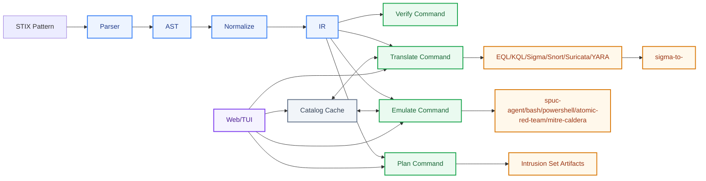
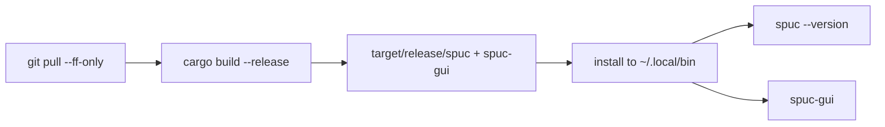
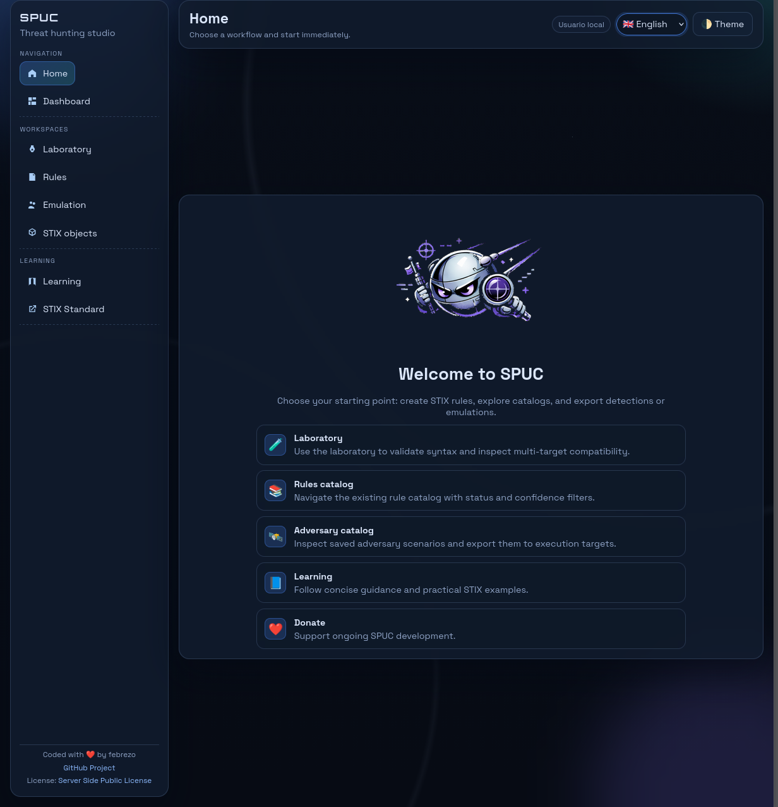
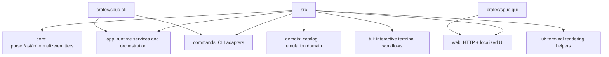

# SPUC (STIX Pattern Universal Converter)

SPUC is a Rust CLI that parses STIX 2.1 patterns, normalizes them to IR, and emits detection content for EQL, KQL, Sigma, Snort, Suricata, and YARA.
When `sigma` is available, SPUC also discovers compatible Sigma backends dynamically and exposes them as `sigma-to-<backend>` targets.



## Status

- Parser: `pest` grammar for STIX-style expressions.
- Normalization: AST to IR (`IrExpr`, `IrPredicate`) with semantic validation.
- Emitters:
  - EQL and KQL for endpoint/EDR-style hunting queries.
  - Sigma for SIEM-style detections.
  - Snort and Suricata for IDS network signatures.
  - YARA for content/malware-style signatures.

## STIX Scope

- STIX 2.1 only.
- Object paths are validated before emitter scoring/conversion.

## Usage

```bash
spuc translate --rule "[ipv4-addr:value = '127.0.0.1']" --to sigma --to eql --to kql
spuc translate --rule "[network-traffic:src_ref.value = '10.0.0.5'] AND [network-traffic:dst_port = 443]" --to snort --to suricata
spuc translate --rule "([process:name = 'cmd.exe'] FOLLOWEDBY [process:name = 'powershell.exe']) WITHIN 300 SECONDS" --to eql
spuc translate --rule "[ipv4-addr:value ISSUBSET '198.51.100.0/24']" --to sigma --to eql --to kql --rule-confidence 80
spuc translate --rule "[process:name = 'cmd.exe']" --to sigma --output ./exports --export csv
spuc emulate --rule "[process:command_line MATCHES '^.*echo.*$']" --to spuc-agent --output ./artifacts
spuc emulate --rule "[process:command_line MATCHES '^.*echo.*$']" --to spuc-agent --output ./artifacts --export csv
spuc emulate --rule "[process:command_line MATCHES '^.*echo.*$']" --to atomic-red-team --to mitre-caldera --output ./artifacts
spuc emulate --rule "[process:command_line MATCHES '^.*echo.*$']" --to spuc-agent --refresh
spuc sigma status
spuc sigma list-targets
spuc sigma update-config
spuc --version
spuc version
```

Behavior notes:

- `translate` prints only translation output.
- `emulate` prints only emulation output.
- Both commands always run a background dual-flow update for catalog convertibility (translation + emulation matrices), cached by normalized `rule_hash` + engine version.
- Use `--refresh` to force cache recomputation.

## Easy Linux Setup (Two Modes)

Use one of these two paths depending on your goal.

### 1) User mode (download latest release manually)

Use this if you just want to run SPUC.

1. Open the GitHub Releases page of this repository.
2. Download the newest Linux asset for your architecture.
   - Typical names: `spuc-vX.Y.Z-x86_64-unknown-linux-gnu.tar.gz` (or `.zip`).
   - Desktop-capable targets bundle `spuc-gui` in the same archive as `spuc` and `spuc-agent`.
   - Current CLI-only targets remain `x86_64-unknown-linux-musl` and `armv7-unknown-linux-gnueabihf`.
3. Extract the archive.
4. Install binaries into your personal Linux path:

```bash
mkdir -p "$HOME/.local/bin"
install -m 0755 ./spuc "$HOME/.local/bin/spuc"
# Optional desktop binary if present in the archive
if [ -f ./spuc-gui ]; then
  install -m 0755 ./spuc-gui "$HOME/.local/bin/spuc-gui"
fi
```

5. Ensure your shell can find that directory:

```bash
grep -q 'HOME/.local/bin' "$HOME/.bashrc" || echo 'export PATH="$HOME/.local/bin:$PATH"' >> "$HOME/.bashrc"
source "$HOME/.bashrc"
```

6. Validate install:

```bash
spuc --version
```

Optional system-wide install (all users):

```bash
sudo install -m 0755 ./spuc /usr/local/bin/spuc
sudo install -m 0755 ./spuc-gui /usr/local/bin/spuc-gui  # if available
```

### 2) Development mode (update source + compile)

Use this if you are modifying SPUC and want fresh binaries after pulling changes.

1. Get latest source:

```bash
git pull --ff-only
```

2. Build release binaries:

```bash
cargo build --release -p spuc-cli --bin spuc
cargo build --release -p spuc-gui
```

3. Install compiled binaries into your Linux path:

```bash
mkdir -p "$HOME/.local/bin"
install -m 0755 ./target/release/spuc "$HOME/.local/bin/spuc"
install -m 0755 ./target/release/spuc-gui "$HOME/.local/bin/spuc-gui"
```

4. Verify:

```bash
spuc --version
spuc-gui --version
```



## CLI Help Sample

```text
$ spuc help

Usage: spuc [COMMAND]

Commands:
  emulate
  jsonrpc
  translate
  verify
  version
  sigma
  web
  help
```

## Testing

```bash
cargo test
cargo test -p spuc-core
cargo test -p spuc-cli
```

## Docker + Compose

The repository includes a production-oriented `Dockerfile` plus a root `docker-compose.yml`.
The image builds `spuc` and `spuc-agent`, persists SPUC state in `/data`, and installs `sigma` with example backend plugins:

- `pysigma-backend-splunk`
- `pysigma-backend-elasticsearch` (ES|QL support)
- `pysigma-backend-crowdstrike` (LogScale)
- `pysigma-backend-secops` (Chronicle / Google SecOps)

SPUC probes `sigma` once on first run, persists runtime results to config cache and then reuses that cache on subsequent starts.
Use `spuc sigma update-config` to force a fresh runtime discovery and overwrite cached Sigma configuration.

Quick start:

```bash
cp .env.example .env
docker compose up --build
```

Run directly from GitHub Container Registry:

```bash
docker pull ghcr.io/febrezo/spuc:latest
docker run --rm -p 8090:8090 \
  -e SPUC_CONFIG_DIR=/data \
  -v spuc_data:/data \
  ghcr.io/febrezo/spuc:latest \
  web --host 0.0.0.0 --port 8090 --admin-user admin --admin-password '<strong-password>' --no-open
```

Deployment guide:

- [Deployment guide](docs/deployment.md): Docker/Compose deployment flow, persistence model, and explanation of every `.env` variable.

Default compose behavior:

- publishes `127.0.0.1:8090` on the host
- runs `spuc web --host 0.0.0.0 --port 8090 --no-open`
- stores web users, catalog, intrusion sets and runtime cache in the named volume `spuc_data`
- supports optional OAuth bootstrap through `SPUC_WEB_GOOGLE_*` and `SPUC_WEB_GITHUB_*`
- supports optional remote Sigma JSON-RPC via `SIGMA_RPC_URL` and `SPUC_SIGMA_RPC_TOKEN`
- supports optional connector bootstrap with `SPUC_ADMIN_API_TOKEN`

The bootstrap admin credentials come from `.env`:

- `SPUC_ADMIN_USER`
- `SPUC_ADMIN_PASSWORD`

For containerized connectors, set `SPUC_ADMIN_API_TOKEN` to provision a fixed administrator API token at startup. SPUC persists only the token hash in `/data/web_user_api_tokens.json`; rotating the environment value updates the same bootstrap token record on restart, and removing the variable revokes that environment-managed token.

## Web Interface

- `spuc` is provided by crate `spuc-cli` and runs the current CLI, including `spuc web`.
- `spuc web` binds to `127.0.0.1` by default, supports `--host` for explicit bind changes such as containers, supports `--no-login`, opens the system browser by default, supports `--no-open` for sidecar/embedded use, and exposes `GET /healthz`.
- `spuc-gui` is a separate Tauri app titled `SPUC: A behavioural IOC mapping lab` that starts `spuc web --no-login --no-open` as a sidecar on an available localhost port, shows a local SPUC loading screen while the sidecar becomes ready, and then loads the local URL in a native window.
- Standard GitHub release archives for desktop-capable targets now ship `spuc`, `spuc-agent`, and `spuc-gui` together in the same versioned asset.
- `spuc-gui` uses `SPUC_LOCALE`, `LC_ALL`, `LC_MESSAGES`, or `LANG` to choose the native window title language at startup and pass the default locale to the embedded web UI; browser mode uses browser language when no saved language preference exists.
- In `spuc-gui`, external links (`https://...`, `mailto:`) open in the system browser while local SPUC routes stay inside the GUI window.
- If `spuc-gui` cannot start the `spuc` sidecar, it exits with a clear error. Build `spuc` first with `cargo build -p spuc-cli --bin spuc`, keep both binaries together, put `spuc` in `PATH`, or set `SPUC_SERVER_BIN=/path/to/spuc`.
- Linux desktop prerequisites: install WebKitGTK, JavaScriptCoreGTK, GTK and GLib development packages. On Fedora: `sudo dnf install glib2-devel gtk3-devel webkit2gtk4.1-devel javascriptcoregtk4.1-devel libappindicator-gtk3-devel librsvg2-devel libxdo-devel pkgconf-pkg-config`. On Ubuntu/WSL: install `libwebkit2gtk-4.1-dev`, `libjavascriptcoregtk-4.1-dev`, `libgtk-3-dev`, `libglib2.0-dev`, `libappindicator3-dev`, `librsvg2-dev`, `libxdo-dev`, and `pkg-config`.
- `spuc web --host 127.0.0.1 --port 8090 --admin-user admin --admin-password <password>` starts the localized web UI on localhost.
- `spuc web --no-login` hides credential-based login and uses a deliberate two-phase local start: the UI first shows a branded SPUC presentation gate with an explicit `Enter SPUC` / `Entrar en SPUC` action, then opens the app shell as local administrator and hides logout while keeping `Settings` available for local administration.
- If `--admin-password` is omitted, SPUC generates a 25-character password and prints it in startup logs.
- Authentication supports local user/password accounts persisted in `<config_root>/web_users.json`.
- User STIX source settings support a local catalog by default and optional per-user OpenCTI GraphQL configuration. Saved OpenCTI API keys are never returned to the frontend, and OpenCTI failures fall back to the local catalog.
- Google/GitHub OAuth login supports authorization code callback flow configured by environment variables (`SPUC_WEB_GOOGLE_CLIENT_ID`, `SPUC_WEB_GOOGLE_CLIENT_SECRET`, `SPUC_WEB_GOOGLE_REDIRECT_URI`, `SPUC_WEB_GITHUB_CLIENT_ID`, `SPUC_WEB_GITHUB_CLIENT_SECRET`, `SPUC_WEB_GITHUB_REDIRECT_URI`).
- Typical local callback URIs are `http://127.0.0.1:8090/api/login/oauth/google/callback` and `http://127.0.0.1:8090/api/login/oauth/github/callback`.
- In `Settings`, administrators can explicitly authorize/disable Google and GitHub login per provider; this policy is persisted in `<config_root>/web_oauth_policy.json` and is enforced in login.
- `Settings` also centralizes per-user theme/language/display-name preferences plus admin-only defaults for theme/language, Sigma translation server connectivity and local user/password management.
- Login/start screen is centered and includes branded logo/title/subtitle plus multi-row footer attribution (coded-with-love by febrezo, GitHub project, license).
- The web UI is localized in English and Spanish only. CLI and JSON-RPC remain unchanged.

### App Home Screenshot



## JSON-RPC Quick Check

```bash
spuc jsonrpc --port 8080
curl -X POST 'http://127.0.0.1:8080/rpc' \
  -H 'Authorization: Bearer <token>' \
  -H 'Content-Type: application/json' \
  --data-raw "{\"rule\":\"[ipv4-addr:value = '1.1.1.1']\",\"to\":[\"sigma\"]}"
```

## MCP Integration

SPUC can be exposed to AI systems through a small MCP adapter that calls `spuc jsonrpc`.
See [`docs/mcp.md`](docs/mcp.md) for:

- practical architecture options (stdio adapter and HTTP bridge)
- a minimal MCP tool contract
- deployment notes for local and containerized setups

## Source Layout



- repository root package `spuc-core`: reusable core library package (`lib` name `spuc`, entrypoint at `src/lib.rs`)
- `crates/spuc-cli/`: `spuc` and `spuc-agent` binaries
- `crates/spuc-gui/`: Tauri desktop app (`spuc-gui`) that manages `spuc web` sidecar lifecycle
- `src/core/`: technical core namespace (`ast`, `ir`, `parser`, `normalize`, `emitters`)
- `src/domain/`: product-domain namespace (`catalog`, emulation-facing integration points)
- `src/app/`: application runner and shared services/cases (`run`, `services/*`)
- `src/commands/`: CLI command adapters (delegate to shared app/domain logic)
- `src/tui/`: interactive console logic
- `src/ui/`: shared terminal styling and rendering helpers
- `src/web/`: localized web UI, lightweight HTTP server and web API adapters

## Abilities

- See dedicated docs in [`docs/abilities.md`](docs/abilities.md).
- Catalog docs: [`docs/catalog.md`](docs/catalog.md).
- Intrusion set docs: [`docs/intrusion-sets.md`](docs/intrusion-sets.md).
- JSON-RPC docs: [`docs/jsonrpc.md`](docs/jsonrpc.md).
- CI/CD governance: [`docs/ci-cd.md`](docs/ci-cd.md).
- MCP integration: [`docs/mcp.md`](docs/mcp.md).

## CI/CD Pipeline

This repository is prepared for automated builds in GitHub Actions:

- `.github/workflows/ci.yml`
  - enforces `cargo fmt --check`, strict clippy (`-D warnings`) and tests for default Rust members, docs build, package/publish dry-run checks, Docker smoke checks, JSON-RPC integration tests, desktop Linux build/tests, and dependency security audit.
- `.github/workflows/dependency-review.yml`
  - blocks PRs that introduce vulnerable or policy-violating dependency changes.
- `.github/workflows/release.yml`
  - builds `spuc` server binaries for Linux, macOS, and Windows.
  - builds `spuc-gui` binaries for the desktop-capable release targets and bundles them into the standard versioned archive with `spuc` and `spuc-agent`.
  - keeps `x86_64-unknown-linux-musl` and `armv7-unknown-linux-gnueabihf` as CLI-only assets because those targets are not supported desktop builds.
  - includes ARM targets for Raspberry Pi (`aarch64-unknown-linux-gnu` and `armv7-unknown-linux-gnueabihf`) plus `x86_64-unknown-linux-musl`.
  - packages artifacts with the current app version in filename (`spuc-v<version>-<target>.tar.gz` / `.zip`).
  - uploads build artifacts on each run.
  - publishes GitHub Release assets and multi-arch GHCR container images automatically when pushing a tag like `v0.1.1`.

## Development Commands

```bash
# Build server CLI binary (`spuc`)
cargo build -p spuc-cli --bin spuc

# Run web server mode
cargo run -p spuc-cli --bin spuc -- web --port 8090 --no-login
cargo run -p spuc-cli --bin spuc -- web --port 8090 --no-login --no-open

# Build desktop app
cargo build -p spuc-gui

# Run desktop app (expects `spuc` next to `spuc-gui`, in PATH, or SPUC_SERVER_BIN set)
cargo run -p spuc-gui

# Force Spanish native window title for a local GUI run
SPUC_LOCALE=es cargo run -p spuc-gui
```

Release flow:

```bash
git tag v0.1.1
git push origin v0.1.1
```

## Available Targets

- `eql`
- `kql`
- `sigma`
- `snort`
- `suricata`
- `yara`
- dynamic: `sigma-to-<backend>` for every compatible backend discovered from `sigma plugin list` (for example `sigma-to-splunk`, `sigma-to-elasticsearch`, `sigma-to-loki`).

Use these inspection commands:

- `spuc sigma status`
- `spuc sigma list-targets`

## Available Emulation Targets

- `spuc-agent`
- `bash`
- `powershell`
- `atomic-red-team`
- `mitre-caldera`

## Semantic Fidelity Status

Each conversion returns exactly one runtime status:

- `exact`: target semantics and data-model assumptions are preserved.
- `schema-dependent`: mapping is valid but depends on backend field schema/profile.
- `backend-dependent`: mapping depends on runtime/backend behavior (regex engine, pipeline, helper semantics).
- `partial`: only a supported subset is emitted; semantic constraints are explicitly omitted/advisory.
- `lossy`: related conversion exists, but semantics are degraded.
- `unsupported`: no honest mapping is available in the current baseline.

Confidence is independent and explicit:

- `conversion_confidence` (`0..100`): SPUC semantic-fidelity confidence.
- `rule_confidence` (`0..100`, optional): analyst/indicator confidence via `--rule-confidence`.

`translate` modes:

- `--mode strict` (default): if required predicates are not representable faithfully, output is `unsupported`.
- `--mode partial`: supported subset only, status `partial`, omitted parts noted.



## Result Model and CSV

Runtime output keeps semantic fidelity and analyst confidence separated:

- `runtime_status`
- `conversion_confidence`
- `rule_confidence`
- `cause`
- `summary`
- `notes`
- `output`

CSV columns:

- `input_rule,target,runtime_status,conversion_confidence,rule_confidence,cause,summary,notes,output`

## Coverage Matrix

This section has two complementary views:

1. Observation operators and qualifiers.
2. Observable path + comparison operator availability.

Important: coverage matrix = availability; runtime status = real semantic fidelity.

### 1) Observation Operators and Qualifiers

| Emitter | `FOLLOWEDBY` | `REPEATS` | `START ... STOP ...` | `WITHIN ... SECONDS` |
| --- | --- | --- | --- | --- |
| EQL | Supported via `sequence` (baseline restrictions apply) | Advisory only (reported in notes, status downgraded to `partial`) | Supported (`@timestamp` filter) | Supported for `FOLLOWEDBY` via `sequence with maxspan`; advisory only in plain where-clause |
| KQL | Not supported | Advisory only (reported in notes, status downgraded to `partial`) | Supported (`Timestamp` filter) | Advisory only (reported in notes) |
| Sigma | Not supported | Advisory only (reported in notes, status downgraded to `partial`) | Not supported | Not supported |
| Snort | Not supported | Not supported | Not supported | Not supported |
| Suricata | Not supported | Not supported | Not supported | Not supported |
| YARA | Not supported | Not supported | Not supported | Not supported |

### 2) Observable Paths (Comparison Operators)

Columns and rows are sorted alphabetically. Each cell shows supported comparison operators for that path and emitter.

| Observable path | EQL | KQL | Sigma | Snort | Suricata | YARA |
| --- | --- | --- | --- | --- | --- | --- |
| `artifact:hashes.MD5` | `= !=` | `= !=` |  |  |  |  |
| `artifact:hashes.SHA-1` | `= !=` | `= !=` |  |  |  |  |
| `artifact:hashes.SHA-256` | `= !=` | `= !=` |  |  |  |  |
| `artifact:hashes.SHA-512` | `= !=` | `= !=` |  |  |  |  |
| `artifact:hashes.SHA3-256` | `= !=` | `= !=` |  |  |  |  |
| `artifact:hashes.SHA3-512` | `= !=` | `= !=` |  |  |  |  |
| `artifact:hashes.SSDEEP` | `= !=` | `= !=` |  |  |  |  |
| `artifact:hashes.TLSH` | `= !=` | `= !=` |  |  |  |  |
| `artifact:mime_type` | `= != LIKE MATCHES` | `= != LIKE MATCHES` |  |  |  |  |
| `artifact:payload_bin` | `= != LIKE MATCHES` | `= != LIKE MATCHES` |  | `= != LIKE MATCHES` | `= != LIKE MATCHES` | `= != LIKE MATCHES` |
| `autonomous-system:name` | `= != LIKE MATCHES` | `= != LIKE MATCHES` | `= != LIKE MATCHES` |  |  |  |
| `autonomous-system:number` | `= != > >= < <=` | `= != > >= < <=` | `= != > >= < <=` |  |  |  |
| `autonomous-system:rir` | `= != LIKE MATCHES` | `= != LIKE MATCHES` | `= != LIKE MATCHES` |  |  |  |
| `directory:atime` | `= != > >= < <=` | `= != > >= < <=` | `= != > >= < <=` |  |  |  |
| `directory:ctime` | `= != > >= < <=` | `= != > >= < <=` | `= != > >= < <=` |  |  |  |
| `directory:mtime` | `= != > >= < <=` | `= != > >= < <=` | `= != > >= < <=` |  |  |  |
| `directory:path` | `= != LIKE MATCHES` | `= != LIKE MATCHES` | `= != LIKE MATCHES` |  |  |  |
| `domain-name:value` | `= != LIKE MATCHES` | `= != LIKE MATCHES` | `= LIKE MATCHES` |  |  |  |
| `email-message:body` | `= != LIKE MATCHES` | `= != LIKE MATCHES` | `= LIKE MATCHES` |  |  | `= != LIKE MATCHES` |
| `email-message:body_multipart[*].body_raw_ref.hashes.'MD5'` | `= !=` | `= !=` | `= !=` |  |  | `= !=` |
| `email-message:body_multipart[*].body_raw_ref.hashes.'SHA-1'` | `= !=` | `= !=` | `= !=` |  |  | `= !=` |
| `email-message:body_multipart[*].body_raw_ref.hashes.'SHA-256'` | `= !=` | `= !=` | `= !=` |  |  | `= !=` |
| `email-message:body_multipart[*].body_raw_ref.hashes.'SHA-512'` | `= !=` | `= !=` | `= !=` |  |  | `= !=` |
| `email-message:body_multipart[*].body_raw_ref.hashes.'SHA3-256'` | `= !=` | `= !=` | `= !=` |  |  | `= !=` |
| `email-message:body_multipart[*].body_raw_ref.hashes.'SHA3-512'` | `= !=` | `= !=` | `= !=` |  |  | `= !=` |
| `email-message:body_multipart[*].body_raw_ref.hashes.SSDEEP` | `= !=` | `= !=` | `= !=` |  |  | `= !=` |
| `email-message:body_multipart[*].body_raw_ref.hashes.TLSH` | `= !=` | `= !=` | `= !=` |  |  | `= !=` |
| `email-message:body_multipart[*].body_raw_ref.name` | `= != LIKE MATCHES` | `= != LIKE MATCHES` | `= LIKE MATCHES` |  |  | `= != LIKE MATCHES` |
| `email-message:from_ref.value` | `= != LIKE MATCHES` | `= != LIKE MATCHES` | `= LIKE MATCHES` |  |  | `= != LIKE MATCHES` |
| `email-message:sender_ref.value` | `= != LIKE MATCHES` | `= != LIKE MATCHES` | `= LIKE MATCHES` |  |  | `= != LIKE MATCHES` |
| `email-message:subject` | `= != LIKE MATCHES` | `= != LIKE MATCHES` | `= LIKE MATCHES` |  |  | `= != LIKE MATCHES` |
| `email-message:to_refs[*].value` | `= != LIKE MATCHES` | `= != LIKE MATCHES` | `= LIKE MATCHES` |  |  | `= != LIKE MATCHES` |
| `file:atime` |  |  | `= != > >= < <=` |  |  |  |
| `file:ctime` |  |  | `= != > >= < <=` |  |  |  |
| `file:hashes.MD5` | `= !=` | `= !=` | `= !=` |  |  | `= !=` |
| `file:hashes.SHA-1` | `= !=` | `= !=` | `= !=` |  |  | `= !=` |
| `file:hashes.SHA-256` | `= !=` | `= !=` | `= !=` |  |  | `= !=` |
| `file:hashes.SHA-512` | `= !=` | `= !=` | `= !=` |  |  |  |
| `file:hashes.SHA3-256` | `= !=` | `= !=` | `= !=` |  |  |  |
| `file:hashes.SHA3-512` | `= !=` | `= !=` | `= !=` |  |  |  |
| `file:hashes.SSDEEP` | `= !=` | `= !=` | `= !=` |  |  |  |
| `file:hashes.TLSH` | `= !=` | `= !=` | `= !=` |  |  |  |
| `file:magic_number_hex` |  |  |  |  |  | `= !=` |
| `file:mtime` |  |  | `= != > >= < <=` |  |  |  |
| `file:name` | `= != LIKE MATCHES` | `= != LIKE MATCHES` | `= != LIKE MATCHES` |  |  |  |
| `file:size` | `= != > >= < <=` | `= != > >= < <=` | `= != > >= < <=` |  |  | `= != > >= < <=` |
| `ipv4-addr:value` | `= != LIKE MATCHES ISSUBSET` | `= != LIKE MATCHES ISSUBSET` |  | `= ISSUBSET` | `= ISSUBSET` |  |
| `ipv6-addr:value` | `= != LIKE MATCHES ISSUBSET` | `= != LIKE MATCHES ISSUBSET` |  |  |  |  |
| `mac-addr:value` | `= != LIKE MATCHES` | `= != LIKE MATCHES` |  |  |  |  |
| `network-traffic:dst_port` | `= != > >= < <=` | `= != > >= < <=` | `=` | `=` | `=` |  |
| `network-traffic:dst_ref.value` | `= != LIKE MATCHES ISSUBSET` | `= != LIKE MATCHES ISSUBSET` | `= LIKE MATCHES ISSUBSET` | `= ISSUBSET` | `= ISSUBSET` |  |
| `network-traffic:protocols` | `= != LIKE MATCHES` | `= != LIKE MATCHES` | `=` | `=` | `=` |  |
| `network-traffic:src_port` | `= != > >= < <=` | `= != > >= < <=` | `=` | `=` | `=` |  |
| `network-traffic:src_ref.value` | `= != LIKE MATCHES ISSUBSET` | `= != LIKE MATCHES ISSUBSET` | `= LIKE MATCHES ISSUBSET` | `= ISSUBSET` | `= ISSUBSET` |  |
| `process:command_line` | `= != LIKE MATCHES` | `= != LIKE MATCHES` | `= != LIKE MATCHES` |  |  |  |
| `process:created_time` | `= != > >= < <=` | `= != > >= < <=` | `= != > >= < <=` |  |  |  |
| `process:cwd` | `= != LIKE MATCHES` | `= != LIKE MATCHES` | `= != LIKE MATCHES` |  |  |  |
| `process:image_ref.hashes.'SHA-256'` | `= !=` | `= !=` | `= !=` |  |  |  |
| `process:image_ref.name` | `= != LIKE MATCHES` | `= != LIKE MATCHES` | `= != LIKE MATCHES` |  |  |  |
| `process:is_hidden` | `= !=` |  | `= !=` |  |  |  |
| `process:parent_ref.command_line` | `= != LIKE MATCHES` | `= != LIKE MATCHES` | `= != LIKE MATCHES` |  |  |  |
| `process:pid` | `= != > >= < <=` | `= != > >= < <=` | `= != > >= < <=` |  |  |  |
| `user-account:account_login` | `= != LIKE MATCHES` | `= != LIKE MATCHES` | `= != LIKE MATCHES` |  |  |  |
| `user-account:account_type` | `= != LIKE MATCHES` | `= != LIKE MATCHES` | `= != LIKE MATCHES` |  |  |  |
| `user-account:user_id` | `= != > >= < <=` | `= != > >= < <=` | `= != > >= < <=` |  |  |  |
| `url:value` | `= != LIKE MATCHES` | `= != LIKE MATCHES` | `= LIKE MATCHES` |  |  |  |
| `windows-registry-key:key` | `= != LIKE MATCHES` | `= != LIKE MATCHES` | `= != LIKE MATCHES` |  |  |  |
| `windows-registry-key:modified_time` | `= != > >= < <=` | `= != > >= < <=` | `= != > >= < <=` |  |  |  |
| `windows-registry-key:number_of_subkeys` |  |  |  |  |  |  |
| `windows-registry-key:values[*].data` | `= != LIKE MATCHES` | `= != LIKE MATCHES` | `= != LIKE MATCHES` |  |  |  |
| `windows-registry-key:values[*].data_type` | `= != LIKE MATCHES` | `= != LIKE MATCHES` | `= != LIKE MATCHES` |  |  |  |
| `windows-registry-key:values[*].name` | `= != LIKE MATCHES` | `= != LIKE MATCHES` | `= != LIKE MATCHES` |  |  |  |

## Hashes and Literal Semantics

For authoritative details on mappings, implementation details, hash coverage, STIX literal handling (`string`, `b'...'`, `h'...'`) and others see guides:

- English guide: `kb/guides/GUIDE_EN.md`
- Spanish guide: `kb/guides/GUIDE_ES.md`

Sample rules and conversions can be found with comments in [`kb/assets/spuc_output.csv`](kb/assets/spuc_output.csv).

## Knowledge Base Layout

- `kb/standards/`: immutable standards/reference files.
- `kb/guides/`: analyst interpretation guides.
- `kb/assets/`: diagrams and sample/generated data.

Immutable files:

- `kb/standards/STIXPattern.g4`
- `kb/standards/stix-v2.1-cs01.html`

See [`kb/README.md`](kb/README.md) for details.

## Analyst Workflow (Examples + Catalog)

```bash
# 1) choose a STIX example
spuc emulate --file examples/process.stix --to spuc-agent --to bash --to atomic-red-team --output ./artifacts

# 2) inspect catalog in web UI
spuc
```

Ready-to-read workflow artifacts:

- `examples/workflow/ability-sample.json`
- `examples/workflow/intrusion-set-sample.yaml`
- `examples/workflow/README.md`

## Engine-Specific Semantics

- Network:
  - `network-traffic:*` is the canonical network family.
  - Standalone network observables can be weaker/context-dependent mappings.
  - `network-traffic:protocols` in STIX is an ordered stack; many backends preserve only one token.
- Artifact payload:
  - `artifact:payload_bin` uses STIX binary normalization.
  - YARA equality is modeled as full-payload equality.
  - Snort/Suricata equality is containment-based (`partial`), regex is backend-dependent.
- User-account:
  - Single-account rules can be supported.
  - Multi-entity conjunctions are rejected in strict mode when single-event semantics cannot be preserved.
- Metadata-heavy families:
  - Directory and autonomous-system are mapped conservatively and usually schema-dependent.

## Final Notes

- Do not assume `exact` from coverage alone; use runtime status and notes.
- Unsupported output is intentional when semantic equivalence is not defensible.
- For maintenance, keep matrix availability and runtime fidelity narratives aligned.

## License

- SSPLv3 (current)
